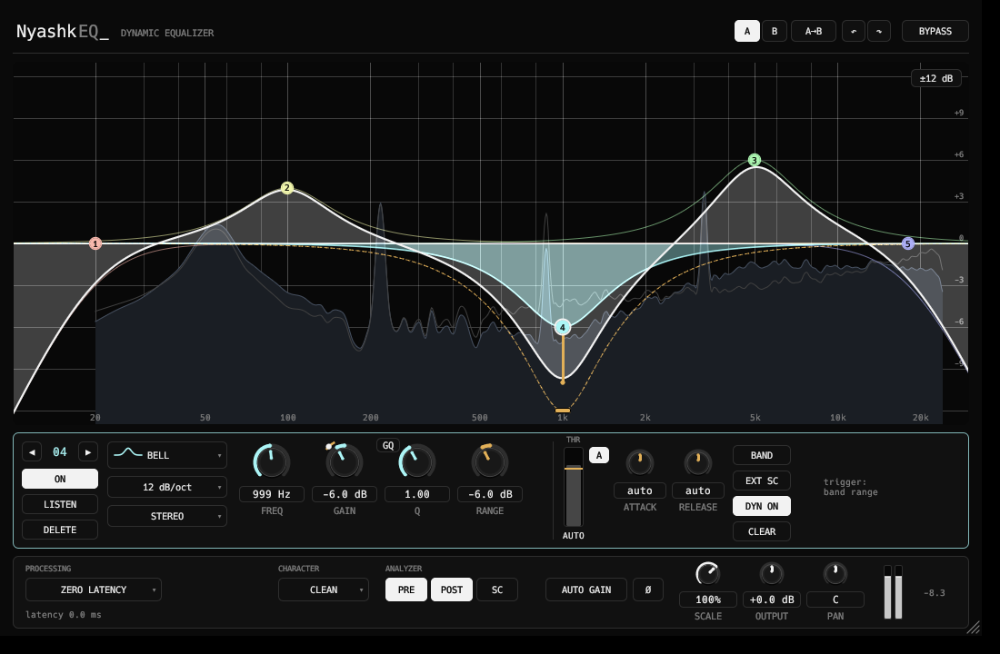

<div align="center">

# NyashkEQ

24-band dynamic equalizer VST3 plugin: Zero Latency / Natural Phase / Linear Phase, ten band shapes up to 96 dB/oct and brickwall, per-band dynamics with side chain, per-band stereo / mid / side placement.

[](https://github.com/xslimakx/NyashkEQ/actions/workflows/build.yml)
[](LICENSE)


[**Download**](https://github.com/xslimakx/NyashkEQ/releases/latest)

</div>

<p align="center"></p>

## Features

- **24 bands**, ten shapes: Bell, Low / High Shelf, Low / High Cut, Notch, Band Pass, Tilt Shelf, Flat Tilt, All Pass. Slopes 6–96 dB/oct, brickwall for cuts. 10 Hz – 30 kHz, ±30 dB, Q 0.025–40, gain-Q interaction.
- **Dynamic EQ** on every bell / shelf / tilt: dynamic range ±30 dB (cut when loud or boost when loud), auto or manual threshold with soft knee, attack / release (auto in the middle), trigger from the band itself or a free low / high cut, **external side chain**, band audition (LISTEN).
- **Spectral dynamics**: per-frequency compression / expansion inside a band (only what sticks out is touched), with density and +3 dB/oct trigger tilt.
- **Processing modes**: Zero Latency (analog-matched filters, no cramping), Natural Phase (adds a short correction FIR: analog magnitude *and* phase, ≈ 8 ms), Linear Phase with five resolutions (dynamics up to High).
- **Per-band placement**: Stereo, Left, Right, Mid, Side.
- Analyzer: pre / post / side chain, range 60 / 90 / 120 dB, resolution Low…Maximum, speed, tilt 0–6 dB/oct, freeze, **spectrum grab** (drag a peak to make a band), **collision** view, **EQ match** to the side chain.
- **EQ Sketch** (draw the curve, bands are fitted), **piano display** (notes on the axis, frequencies snap to notes).
- Character (Clean / Subtle / Warm, oversampled), auto gain, gain scale (−100…200 %), output gain / pan / phase, A/B, undo / redo, display range 3 / 6 / 12 / 30 dB.
- Display: double-click = new band (Alt = dynamic), drag = frequency / gain (Shift = fine), wheel = Q, Alt + wheel = dynamic range, right-click = menu (shape, slope, placement, make dynamic, invert gain, reset, duplicate), double-click a dot = delete, rubber-band and Shift multi-select, Delete key.

## Install
Use the Nyashk Launcher, or unzip the `.vst3` bundle from the latest release into your VST3 folder.

## Build
```
cargo xtask bundle -p nyashkeq --release
```
The bundle appears in `target/bundled/`.

## License
MIT

## Credits

The GUI uses the Inter typeface by Rasmus Andersson (SIL Open Font License 1.1, see `plugins/nyashkeq/assets/Inter-LICENSE.txt`).
